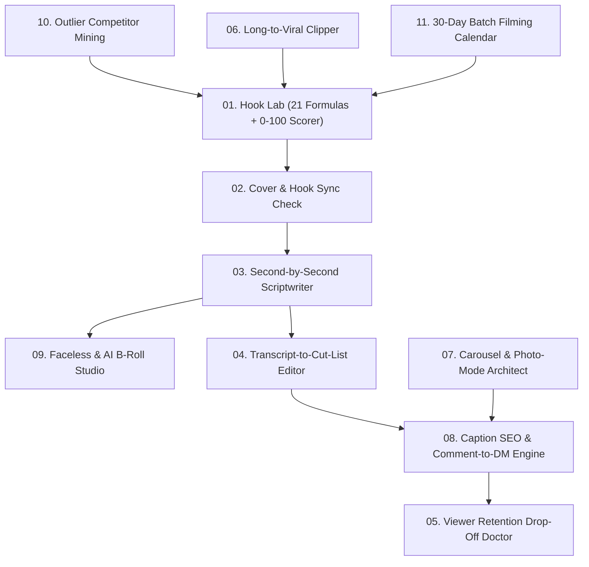

# `instagram-tiktok-agent-skill` — Run an Entire Instagram Reels & TikTok Channel with 11 AI Agent Skills

[](LICENSE)
[](https://www.python.org/)
[](https://github.com/andrew4522-cr/instagram-tiktok-agent-skill)

> **Scripts, 21 hook formulas, cover-to-hook alignment, transcript cut lists, viewer retention diagnostics, long-to-short clipping, and faceless video production — everything broken down so you can hand each step off to Claude, Cursor, or Antigravity one by one.**

Built by **Andrew Anderson** ([BridgingTheAIGap.com](https://www.bridgingtheaigap.com) / [CULT](https://www.cult.rent)).

---

## Why This Repository Exists

Instagram Reels and TikTok courses charge thousands of dollars for hook formulas, grid-cover rules, retention graph diagnostics, and content repurposing systems.

Here, the entire system is encoded as **11 modular AI Agent Skills (`skills/01` to `skills/11`)** plus a **zero-dependency Python CLI engine (`ig-tiktok-skill`)**, released 100% free under the MIT license.

Whether you are a founder, a creator who gets burned out scripting and organizing edits after work, an info channel running **faceless videos**, or a side-hustler turning blog posts and software demos into daily Reels and TikToks, this repo turns 6 hours of weekly guesswork into a repeatable 45-minute pipeline.

---

## Architecture: How the 11 Skills Fit Together



---

## What's Inside: The 11 Skills Broken Down Simply

| # | Skill Folder | What It Does |
| :--- | :--- | :--- |
| **01** | **[`01-hook-lab`](skills/01-hook-lab/SKILL.md)** | **21 Hook Formulas + 0–100 Scorer:** Generates the critical `0–3s` opening across all 3 channels simultaneously (**Said** [spoken audio], **Seen** [visual action], and **Text Overlay**), tagging `[Proof]`, `[Promise]`, and `[Plan]`. Scores how strong your opening hook is before you ever press record. |
| **02** | **[`02-cover-and-hook-sync`](skills/02-cover-and-hook-sync/SKILL.md)** | **Cover Frame & Hook Alignment:** Doesn't check your Grid Cover and Spoken Hook separately—inspects them **as a single set**. Reels and TikToks where the cover headline and opening 3 seconds don't match are the #1 cause of instant swipe-aways. |
| **03** | **[`03-shortform-scriptwriter`](skills/03-shortform-scriptwriter/SKILL.md)** | **Second-by-Second Beat Scripting:** Writes tight 15s, 30s, and 60s scripts laid out in synchronized `[Visual / B-Roll]`, `[Spoken Audio]`, and `[On-Screen Text]` columns with a visual pattern-interrupt every 3.5 seconds. |
| **04** | **[`04-transcript-cut-list`](skills/04-transcript-cut-list/SKILL.md)** | **Editing Instructions from Raw Transcript:** Feed it the transcript of your recorded footage (fumbles, repeated takes, filler words included). It outputs an exact editing cut list of what to remove, where to jump-cut, where to punch-in zoom, and where to drop B-roll. |
| **05** | **[`05-retention-dropoff-doctor`](skills/05-retention-dropoff-doctor/SKILL.md)** | **Viewer Retention Drop-Off Analysis:** Instead of fixing videos by gut feeling, feed it your **3-second hold rate**, **average watch time**, and **completion %**. It pinpoints the exact timestamp where viewers drop off (`0:02` hook bleed, `0:08` mid-video sag, or `0:25` outro sign-off) and rewrites the weak beat. |
| **06** | **[`06-long-to-viral-clipper`](skills/06-long-to-viral-clipper/SKILL.md)** | **Viral Shorts / Reels Repurposing Engine:** Pulls standalone 30–45s micro-stories out of long YouTube videos, podcasts, or blog posts—and bolts on a brand-new `0–3s` cold-open hook so cold FYP viewers don't swipe away. |
| **07** | **[`07-carousel-architect`](skills/07-carousel-architect/SKILL.md)** | **Swipe-Stop Carousels & TikTok Photo Mode:** Designs 7–10 slide carousels using the **Slide-1 + Slide-2 Double-Hook Rule** (since Instagram automatically re-serves Slide 2 to followers who scrolled past Slide 1). |
| **08** | **[`08-caption-seo-and-manychat`](skills/08-caption-seo-and-manychat/SKILL.md)** | **TikTok/IG Search SEO & Comment-to-DM Triggers:** Writes keyword-indexed captions and high-velocity comment triggers (*"Comment 'SYSTEM' and I'll DM you the blueprint"*) that boost algorithmic reach while capturing leads. |
| **09** | **[`09-faceless-and-ai-broll`](skills/09-faceless-and-ai-broll/SKILL.md)** | **Faceless Channel & Screen-Demo Studio:** Built for creators and side-hustlers who don't want to show their face: generates screen-recording choreography, hands-only POV setups, and AI video B-roll prompts. |
| **10** | **[`10-outlier-competitor-mining`](skills/10-outlier-competitor-mining/SKILL.md)** | **Outlier Teardown & Structural Cloning:** Finds competitor videos that hit `3x–10x` their normal views, strips out their topic, and clones the underlying timing and hook skeleton for your niche. |
| **11** | **[`11-30day-batch-calendar`](skills/11-30day-batch-calendar/SKILL.md)** | **90-Minute Monthly Batch Filming System:** Organizes 30 days of Reels, TikToks, and Carousels by *filming setup* instead of calendar date so you can record a full month in one 90-minute Sunday session. |

---

## Quickstart

### 1. Install the Skill Pack into Claude Code, Cursor, or Antigravity

```bash
git clone https://github.com/andrew4522-cr/instagram-tiktok-agent-skill.git
cd instagram-tiktok-agent-skill
pip install -e .

# Copy the 11 skills into your agent's skills directory:
cp -r skills/* ~/.claude/skills/     # For Claude Code
cp -r skills/* ~/.cursor/skills/     # For Cursor
cp -r skills/* ~/.gemini/config/skills/  # For Google Antigravity
```

### 2. Use the Command-Line Scoring & Editing Engine (`ig-tiktok-skill`)

```bash
# 1. Score a 0-3s Hook across all 3 channels (0-100 Score + Grade + Fixes)
ig-tiktok-skill --score-hook "Stop spending four thousand euro a month on manual reporting when you can automate it in 15 minutes." \
  --seen "Cursor circles €4,000 spreadsheet cell then cuts to live automated dashboard" \
  --overlay "€4,000/mo -> €200/mo"

# 2. Check Cover Frame + Headline + Spoken Hook alignment as a single set
ig-tiktok-skill --check-alignment \
  "€4,000/mo Manual Reporting Fix" \
  "Founder pointing at highlighted spreadsheet cell in center 1:1 grid safe zone" \
  "A client was spending €4,000 a month on manual reporting until we automated it."

# 3. Turn a messy raw recording transcript into a frame-by-frame Editing Cut List
ig-tiktok-skill --cut-list "Hey guys welcome back. A client was spending €4,000 a month on manual reporting. We replaced the entire process in 15 minutes. Comment SYSTEM for the free blueprint."

# 4. Diagnose a stalled Reel/TikTok's viewer retention drop-off (3s Hold %, Avg Watch %, Completion %)
ig-tiktok-skill --diagnose-retention 52 38 18

# 5. List all 21 viral hook formulas
ig-tiktok-skill --list-formulas
```

---

## Running Tests

```bash
python -m unittest discover -s tests -v
```

---

## License

MIT License © 2026 [Andrew Anderson](https://www.bridgingtheaigap.com)
